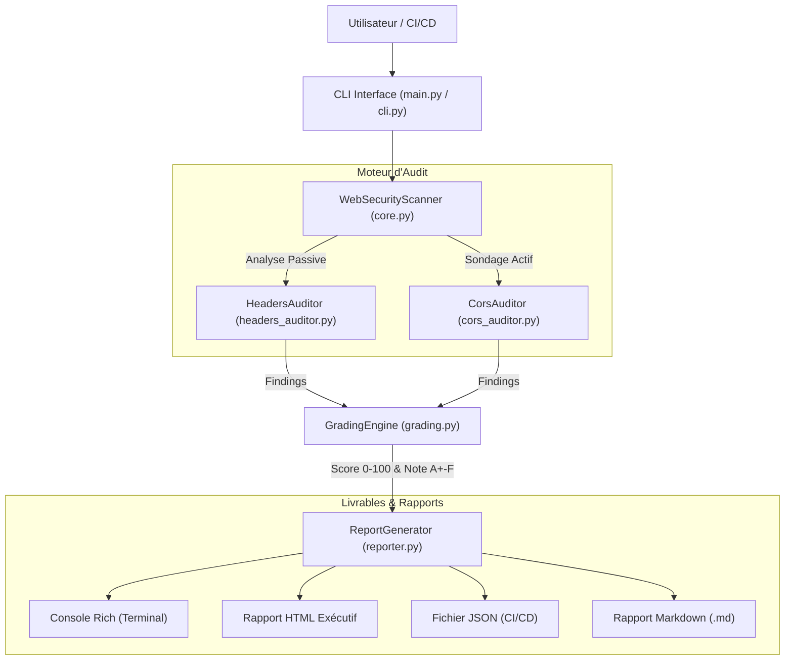

# 🛡️ Automated Web Security Scanner: Headers & CORS Audit

[](https://python.org)
[](LICENSE)
[-orange.svg?style=flat-square&logo=owasp&logoColor=white)](https://owasp.org)
[](tests/)
[](https://github.com/psf/black)
[]()

> **Projet de fin de Bootcamp en Cybersécurité / Cybersecurity Capstone Project**  
> *"Automated Web Scanner: Programmed a Python script to audit sites for secure headers and CORS flaws."*

---

## 📌 Présentation du Projet (Résumé en Français)

Ce projet a été conçu et développé dans le cadre de la soutenance finale de validation des acquis en **Cybersécurité**. Il s'agit d'un **scanner de vulnérabilités web automatisé de niveau professionnel** développé en **Python 3**. 

L'outil combine :
1. **L'audit approfondi des en-têtes de sécurité HTTP (Secure Headers)** pour vérifier la résilience de l'application face aux attaques de type Clickjacking, MIME Sniffing, XSS, et SSL Stripping (norme OWASP Secure Headers).
2. **Un moteur de sondage actif des vulnérabilités CORS (Cross-Origin Resource Sharing)** basé sur le standard RFC 6454 (détection des réflexions d'origines malveillantes, fuite de cookies/sessions, et contournements par origine `null` ou expressions régulières faibles).
3. **Un système de scoring et de notation (de A+ à F)** avec classification CVSS v3.1 / OWASP Top 10.
4. **La génération automatique de rapports multi-formats** : terminal interactif stylisé (Rich), tableau de bord **HTML exécutif moderne**, exports **JSON** (compatible pipelines CI/CD DevSecOps) et **Markdown**.
5. **Un banc de test embarqué (Demo Server)** permettant de tester et démontrer l'outil hors-ligne lors d'un examen ou d'une présentation.

---

## 🚀 Key Features / Fonctionnalités Clés

- **🎯 Double Moteur d'Audit :**
  - **Audit Passif des En-têtes HTTP** : Analyse minutieuse des directives de défense en profondeur.
  - **Sondage Actif CORS (Active Probing)** : Émission de vecteurs de test dynamiques pour identifier les configurations permissives réelles.
- **🚨 Détection des Failles CORS Critiques :**
  - Réflexion dynamique d'origines tierces arbitraires avec `Access-Control-Allow-Credentials: true` (Vol de session/CSRF).
  - Confiance accordée à l'origine `null` (exploit via `<iframe sandbox="allow-scripts">`).
  - Contournements de regex par préfixe ou suffixe mal ancré (`https://cible.com.attaquant.com`).
  - Analyse approfondie des requêtes prévol (`OPTIONS`) et durées de cache excessives.
- **🛡️ Conformité OWASP Secure Headers :**
  - `Strict-Transport-Security` (HSTS) : validation `max-age`, `includeSubDomains`, `preload`.
  - `Content-Security-Policy` (CSP) : détection de `'unsafe-inline'`, `'unsafe-eval'`, wildcards `*`.
  - `X-Frame-Options` : protection contre le Clickjacking (UI Redressing).
  - `X-Content-Type-Options` : protection contre le MIME-sniffing (`nosniff`).
  - `Referrer-Policy` & `Permissions-Policy` (contrôle des APIs matérielles : caméra, micro, géolocalisation).
  - `COOP` / `COEP` (Isolation mémoire contre Spectre).
  - Détection de fuite d'informations (Server banners, `X-Powered-By`, versions logicielles).
- **📊 Système de Scoring & Notation Professionnel :**
  - Score pondéré de 0 à 100 et note de posture globale : **A+, A, B, C, D, F**.
  - Règle de plafonnement critique : toute faille critique (CORS avec credentials) abaisse immédiatement la note à D ou F.
- **📄 Rapports Multi-Formats Exportables :**
  - **Terminal Coloré (Rich)** avec tableaux et synthèses exécutives.
  - **Tableau de Bord HTML** responsive, thème cyber sombre, prêt pour impression PDF / livrable client.
  - **Format JSON normalisé** pour ingestion automatisée.
  - **Format GitHub Markdown** pour issues et tickets de remédiation.
- **⚡ DevSecOps Ready :**
  - Option `--fail-on HIGH` pour bloquer les pipelines CI/CD en cas de régression de sécurité.
  - Support de proxy pour interception (Burp Suite, OWASP ZAP).
- **🧪 Serveur de Test Local Intégré :**
  - Serveur Python léger sans dépendance externe simulant des endpoints vulnérables et durcis.

---

## 🏗️ Architecture du Système



---

## ⚡ Installation Rapide

### Prérequis
- Python 3.8 ou supérieur

### Procédure d'installation

```bash
# 1. Cloner ou se positionner dans le dossier du projet
cd cybersecurity-bootcamp-project

# 2. Créer un environnement virtuel (recommandé)
# Sur Windows :
python -m venv .venv
.\.venv\Scripts\Activate.ps1

# Sur Linux / macOS :
python3 -m venv .venv
source .venv/bin/activate

# 3. Installer les dépendances
pip install -r requirements.txt

# 4. (Optionnel) Installer le package en mode éditable pour avoir la commande système
pip install -e .
```

---

## 💻 Guide d'Utilisation

### 1. Audit d'une Cible Unique
```bash
python main.py scan https://example.com
```

### 2. Générer des Rapports HTML, JSON et Markdown
```bash
python main.py scan https://example.com --html rapport.html --json rapport.json --markdown rapport.md
```

### 3. Exécuter un Audit par Lots (Batch Scanning)
Créez un fichier `targets.txt` contenant les URLs à analyser :
```text
https://owasp.org
https://github.com
http://127.0.0.1:8888/vulnerable/cors-reflected-creds
```
Lancez l'audit :
```bash
python main.py batch targets.txt --output-dir mes_rapports --html --json
```

### 4. Utilisation en Pipeline DevSecOps (Security Gating)
Interrompez le build si une vulnérabilité d'au moins niveau `HIGH` ou `CRITICAL` est détectée :
```bash
python main.py scan https://staging.mon-application.com --fail-on HIGH
```
*(Le script quitte avec un code d'erreur `1` en cas d'échec de conformité).*

### 5. Utilisation avec Burp Suite / OWASP ZAP (Proxy)
```bash
python main.py scan https://example.com -p http://127.0.0.1:8080 -k
```

---

## 🧪 Démonstration Hors-Ligne (Serveur de Test Intégré)

Pour démontrer le fonctionnement du scanner sans dépendre d'une connexion internet :

**Terminal 1 — Lancer le serveur de test :**
```bash
python main.py demo-server --port 8888
```

**Terminal 2 — Auditer les différents scénarios :**
```bash
# 1. Scénario CRITIQUE : CORS avec réflexion d'origine et cookies (Note F)
python main.py scan http://127.0.0.1:8888/vulnerable/cors-reflected-creds --html rapport_critique.html

# 2. Scénario ÉLEVÉ : Confiance aveugle en l'origine 'null'
python main.py scan http://127.0.0.1:8888/vulnerable/cors-null

# 3. Scénario MOYEN : Content-Security-Policy permissive ('unsafe-inline')
python main.py scan http://127.0.0.1:8888/vulnerable/weak-csp

# 4. Scénario DURCI (Defense-in-depth) : Note A+ (Score 100/100)
python main.py scan http://127.0.0.1:8888/secure/hardened --html rapport_securise.html
```

---

## 📋 Matrice des Vulnérabilités Détectées

| Identifiant | Règle / Vulnérabilité | Sévérité | Référence OWASP | CWE |
| :--- | :--- | :--- | :--- | :--- |
| `CORS-CRIT-REFLECTION` | Réflexion d'origine arbitraire avec Credentials (`ACAC: true`) | **CRITICAL** | A01:2021-Broken Access Control | CWE-942 |
| `CORS-NULL-01` | Autorisation de l'origine `null` (Bypass via Sandboxed iframes) | **HIGH** | A01:2021-Broken Access Control | CWE-942 |
| `CORS-REFL-SUBDOMAIN` | Biais d'expression régulière (Suffixe / Préfixe arbitraire) | **HIGH / MEDIUM** | A01:2021-Broken Access Control | CWE-942 |
| `HDR-HSTS-01` | En-tête HSTS manquant sur un point de terminaison HTTPS | **HIGH** | A05:2021-Security Misconfiguration | CWE-319 |
| `HDR-CSP-01` | En-tête Content-Security-Policy (CSP) manquant | **HIGH** | A05:2021-Security Misconfiguration | CWE-79 |
| `HDR-CSP-02` | Directive CSP permissive : utilisation de `'unsafe-inline'` | **MEDIUM** | A05:2021-Security Misconfiguration | CWE-79 |
| `HDR-CSP-03` | Directive CSP permissive : utilisation de `'unsafe-eval'` | **MEDIUM** | A05:2021-Security Misconfiguration | CWE-79 |
| `HDR-XFO-01` | Défense anti-Clickjacking manquante (`X-Frame-Options`) | **MEDIUM** | A05:2021-Security Misconfiguration | CWE-1021 |
| `HDR-XCTO-01` | Protection contre le MIME-sniffing manquante (`nosniff`) | **LOW** | A05:2021-Security Misconfiguration | CWE-430 |
| `HDR-RP-01` | En-tête Referrer-Policy manquant ou insécurisé | **LOW** | A05:2021-Security Misconfiguration | CWE-200 |
| `HDR-LEAK-*` | Fuite de bannières technologiques (`Server`, `X-Powered-By`) | **LOW / INFO** | A05:2021-Security Misconfiguration | CWE-200 |

---

## 📊 Barème de Notation (Grading Scale)

| Note | Intervalle de Score | Posture de Sécurité & Statut |
| :---: | :---: | :--- |
| **A+** | 95 - 100 | **Excellente** — Tous les en-têtes défensifs présents, HSTS preload, CSP strict, aucun défaut CORS. |
| **A** | 85 - 94 | **Très Bonne** — Pratiques de sécurité solides, absence de vulnérabilités élevées. |
| **B** | 70 - 84 | **Bonne** — Défenses principales actives, quelques ajustements mineurs requis. |
| **C** | 55 - 69 | **Moyenne** — En-têtes critiques manquants (ex: Clickjacking ou HSTS manquant). |
| **D** | 40 - 54 | **Insuffisante** — Multiples défenses absentes ou CSP inopérant. |
| **F** | 0 - 39 | **Critique** — Faille CORS critique détectée ou exposition majeure aux attaques. |

---

## 🧪 Tests Unitaires & Assurance Qualité

Le projet inclut une suite de tests unitaires avec `pytest` validant chaque composant :
```bash
python -m pytest tests/ -v
```

### GitHub Actions CI Workflow
Le workflow `.github/workflows/ci.yml` exécute automatiquement :
- Le linter `flake8` pour l'intégrité du code.
- L'analyseur de sécurité statique `bandit`.
- L'ensemble des 16 tests unitaires sur Python 3.10, 3.11, 3.12 et 3.13.

---

## 📁 Structure du Projet

```
cybersecurity-bootcamp-project/
├── .github/
│   └── workflows/
│       └── ci.yml                     # Pipeline CI/CD GitHub Actions
├── docs/
│   ├── ARCHITECTURE.md                # Spécification d'architecture logicielle
│   ├── METHODOLOGY.md                 # Concepts théoriques CORS & Headers (OWASP)
│   ├── USER_GUIDE.md                  # Guide d'utilisation détaillé
│   └── BOOTCAMP_DEFENSE_SHEET.md      # Fiche de préparation pour la soutenance orale
├── examples/
│   ├── sample_report.html             # Exemple de rapport HTML exécutif généré
│   ├── sample_report.json             # Exemple de rapport JSON
│   ├── sample_report.md               # Exemple de rapport Markdown
│   └── targets.txt                    # Liste de cibles d'exemple pour scan par lot
├── scanner/
│   ├── __init__.py                    # Exports du package et métadonnées
│   ├── cli.py                         # Interface en ligne de commande (CLI)
│   ├── core.py                        # Orchestrateur central de l'audit
│   ├── cors_auditor.py                # Moteur de sondage actif CORS (RFC 6454)
│   ├── demo_server.py                 # Serveur de test local autonome
│   ├── grading.py                     # Moteur de calcul des scores et notes (A+ à F)
│   ├── headers_auditor.py             # Moteur d'audit des en-têtes (OWASP)
│   ├── models.py                      # Structures de données et Enums
│   └── reporter.py                    # Générateur de rapports (Terminal, HTML, JSON, MD)
├── tests/
│   ├── __init__.py
│   ├── test_cli.py                    # Tests de la CLI et des sorties
│   ├── test_cors.py                   # Tests de détection des failles CORS
│   ├── test_grading.py                # Tests du barème de notation
│   └── test_headers.py                # Tests des règles d'audit d'en-têtes
├── .gitignore                         # Fichiers et dossiers ignorés par Git
├── LICENSE                            # Licence Open Source MIT
├── main.py                            # Point d'entrée principal (script exécutable)
├── pyproject.toml                     # Configuration moderne de packaging Python
├── requirements.txt                   # Dépendances de production
├── requirements-dev.txt               # Dépendances de développement et tests
├── setup.py                           # Fichier d'installation pip
└── README.md                          # Documentation principale du projet
```

---

## 📚 Documentation Additionnelle

Pour préparer votre soutenance ou approfondir les concepts :
- **[Fiche de Soutenance Orale](docs/BOOTCAMP_DEFENSE_SHEET.md)** : Questions types du jury, réponses argumentées et guide de pitch.
- **[Méthodologie & Théorie Cybersécurité](docs/METHODOLOGY.md)** : Fonctionnement de la SOP, détails des RFCs, vecteurs d'attaque et remédiations de code (Nginx, Apache, Express, FastAPI).
- **[Architecture Système](docs/ARCHITECTURE.md)** : Diagrammes détaillés des composants et flux de données.
- **[Manuel Utilisateur](docs/USER_GUIDE.md)** : Options détaillées de la CLI et exemples avancés.

---

## ⚖️ Avertissement Éthique & Légal (Disclaimer)

Ce logiciel a été développé à des fins éducatives et d'audit de sécurité défensif. Vous ne devez utiliser cet outil que sur des systèmes et applications web pour lesquels vous avez obtenu une **autorisation explicite et préalable du propriétaire**. L'auteur décline toute responsabilité en cas d'utilisation non conforme ou malveillante de ce logiciel.

---

## 👤 Auteur

- **Kone Bienvenu** ([@konebienvenu](https://github.com/konebienvenu))
- Dépôt officiel : [Automated-Web-Scanner](https://github.com/konebienvenu/Automated-Web-Scanner)
- Sujet : *Automated Web Scanner: Programmed a Python script to audit sites for secure headers and CORS flaws.*
- Licence : [MIT License](LICENSE)
