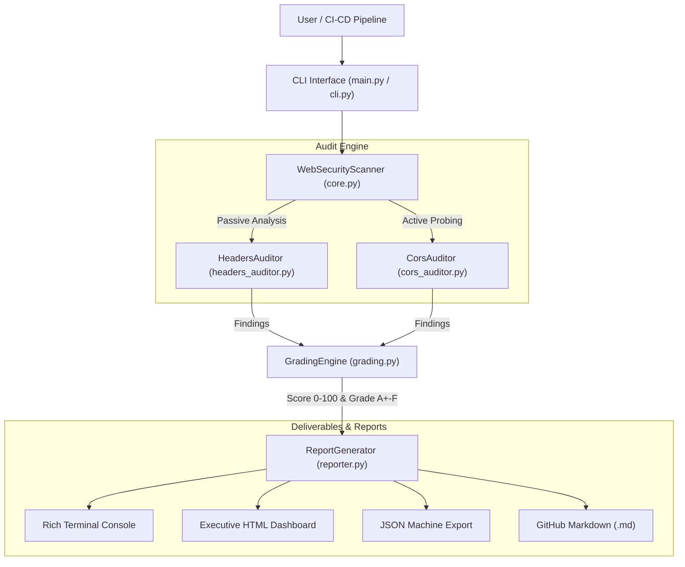

# 🛡️ Automated Web Security Scanner: Headers & CORS Audit

[](https://python.org)
[](LICENSE)
[-orange.svg?style=flat-square&logo=owasp&logoColor=white)](https://owasp.org)
[](tests/)
[](https://github.com/psf/black)
[]()

> **Cybersecurity Bootcamp Capstone Project**  
> *"Automated Web Scanner: Programmed a Python script to audit sites for secure headers and CORS flaws."*

---

## 📌 Project Overview

**Automated Web Security Scanner** is an enterprise-grade web vulnerability scanner developed in **Python 3**. Built as a capstone project to demonstrate mastery of modern defensive web security, it provides automated compliance auditing, risk scoring, and active exploitation probing for two primary web attack surfaces:

1. **Passive HTTP Security Headers Audit**: Validates browser-side defense-in-depth mechanisms according to **OWASP Secure Headers Project** standards (mitigating Clickjacking, MIME-sniffing, XSS, and SSL stripping).
2. **Active CORS (Cross-Origin Resource Sharing) Probing Engine**: Dispatches dynamic test vectors based on the **W3C / RFC 6454** standard (detecting arbitrary origin reflection, credential exposure, `null` origin trust, and unanchored regular expression bypasses).
3. **Automated Risk Scoring & Letter Grade Algorithm**: Computes CVSS v3.1-aligned security posture scores from `0` to `100` and assigns letter grades from **A+ to F**.
4. **Multi-Format Deliverables**: Produces styled terminal outputs, interactive dark-themed **HTML executive dashboards**, CI/CD-ready **JSON** schemas, and GitHub-flavored **Markdown** reports.
5. **Integrated Mock Testbed Server**: An embedded Python test server simulating vulnerable and hardened endpoints for reliable, offline, reproducible demonstrations.

---

## 🚀 Key Features

- **🎯 Dual-Engine Architecture:**
  - **Passive Header Analysis**: Comprehensive heuristics for defensive directives and deprecation checks.
  - **Active CORS Probing**: Real-time probe injection testing live server responses against malicious origins.
- **🚨 Critical CORS Vulnerability Detection:**
  - Arbitrary origin reflection with `Access-Control-Allow-Credentials: true` (Critical SOP bypass / authenticated data theft).
  - Dangerous trust of `Origin: null` (exploitable via sandboxed iframes `<iframe sandbox="allow-scripts">` and `data:` URIs).
  - Weak regular expression prefix/suffix matching flaws (e.g., `https://target.com.attacker.com`).
  - Preflight `OPTIONS` method scrutiny and excessive cache duration (`Access-Control-Max-Age`).
- **🛡️ OWASP Secure Headers Audited:**
  - `Strict-Transport-Security` (HSTS): Enforces HTTPS, verifies `max-age`, `includeSubDomains`, and `preload`.
  - `Content-Security-Policy` (CSP): Flags insecure `'unsafe-inline'`, `'unsafe-eval'`, and wildcards `*`.
  - `X-Frame-Options`: Enforces Clickjacking protection (`DENY` / `SAMEORIGIN`) or CSP `frame-ancestors`.
  - `X-Content-Type-Options`: Enforces `nosniff` against MIME-sniffing exploits.
  - `Referrer-Policy`: Prevents confidential token/query leakage in referrer headers.
  - `Permissions-Policy`: Restricts browser hardware APIs (camera, microphone, geolocation).
  - `COOP` / `COEP`: Cross-origin process isolation protecting against Spectre-class side-channels.
  - Information Disclosure Banner Grabbing: Detects exposed `Server`, `X-Powered-By`, and runtime framework versions.
- **📊 Security Scoring & Letter Grade (A+ to F):**
  - Weighted penalty deductions based on CVSS severity.
  - Critical cap rule: any critical CORS vulnerability automatically restricts maximum grade to **D** or **F**.
- **📄 Multi-Format Reporting:**
  - **Rich Interactive Terminal**: ANSI color-coded tables, severity badges, and executive cards.
  - **Executive HTML Dashboard**: Standalone responsive dark-theme report with charts, badges, and print-ready CSS.
  - **Structured JSON Export**: Machine-readable format designed for DevSecOps pipeline ingestion.
  - **GitHub Markdown**: Formatted for audit documentation and pull request reviews.
- **⚡ DevSecOps & CI/CD Ready:**
  - Exit code gating via `--fail-on HIGH` to block deployment pipelines when high or critical findings are detected.
  - Proxy support (`-p / --proxy`) for traffic inspection with Burp Suite or OWASP ZAP.
- **🧪 Built-In Testbed Server:**
  - Standard library mock server (`main.py demo-server`) to demonstrate scanner accuracy offline.

---

## 🏗️ System Architecture



---

## ⚡ Installation & Setup

### Prerequisites
- Python 3.8 or higher
- Git

### Installation Steps

```bash
# 1. Clone the repository
git clone https://github.com/konebienvenu/Automated-Web-Scanner.git
cd Automated-Web-Scanner

# 2. Create and activate a virtual environment (recommended)
# On Windows (PowerShell):
python -m venv .venv
.\.venv\Scripts\Activate.ps1

# On Linux / macOS:
python3 -m venv .venv
source .venv/bin/activate

# 3. Install core dependencies
pip install -r requirements.txt

# 4. (Optional) Install in editable mode to register system-wide CLI command
pip install -e .
```

---

## 💻 Usage Guide

### 1. Single Target Audit
```bash
python main.py scan https://example.com
```

### 2. Export HTML, JSON, and Markdown Reports
```bash
python main.py scan https://example.com --html report.html --json report.json --markdown report.md
```

### 3. Batch Audit Multiple Sites (Using Dataset)
The scanner includes a curated dataset of target endpoints and test cases in [`examples/targets.txt`](https://github.com/konebienvenu/Automated-Web-Scanner/blob/main/examples/targets.txt):
```text
https://owasp.org
https://github.com
http://127.0.0.1:8888/vulnerable/cors-reflected-creds
```
Run batch audit across the dataset:
```bash
python main.py batch examples/targets.txt --output-dir reports/ --html --json
```

### 4. CI/CD Security Gating (DevSecOps)
Enforce automated security gating by halting deployment builds if findings meet or exceed a severity threshold:
```bash
python main.py scan https://staging.internal.net --fail-on HIGH
```
*(Returns exit code `1` if CRITICAL or HIGH vulnerabilities exist, otherwise returns `0`).*

### 5. Proxy Routing (Burp Suite / OWASP ZAP)
```bash
python main.py scan https://example.com -p http://127.0.0.1:8080 -k
```

---

## 🧪 Live Demonstration (Built-In Mock Testbed)

To validate or demonstrate scanner capabilities offline without external internet connectivity:

**Terminal 1 — Launch the Mock Testbed Server:**
```bash
python main.py demo-server --port 8888
```

**Terminal 2 — Execute Audit Scenarios:**
```bash
# 1. CRITICAL Scenario: Arbitrary Origin Reflection + Credentials (Grade F)
python main.py scan http://127.0.0.1:8888/vulnerable/cors-reflected-creds --html report_vuln.html

# 2. HIGH Scenario: Dangerous Trust of 'null' Origin
python main.py scan http://127.0.0.1:8888/vulnerable/cors-null

# 3. MEDIUM Scenario: Weak CSP containing 'unsafe-inline' and 'unsafe-eval'
python main.py scan http://127.0.0.1:8888/vulnerable/weak-csp

# 4. HARDENED Scenario: Defense-in-Depth Implementation (Grade A+ / 100 Score)
python main.py scan http://127.0.0.1:8888/secure/hardened --html report_secure.html
```

---

## 📋 Vulnerability Detection Matrix

| Rule ID | Finding Title | Severity | OWASP Top 10 | CWE ID |
| :--- | :--- | :--- | :--- | :--- |
| `CORS-CRIT-REFLECTION` | Reflected Origin with Credentials (`ACAC: true`) | **CRITICAL** | A01:2021-Broken Access Control | CWE-942 |
| `CORS-NULL-01` | Insecure Trust of `null` Origin (Sandboxed iframe bypass) | **HIGH** | A01:2021-Broken Access Control | CWE-942 |
| `CORS-REFL-SUBDOMAIN` | Weak Regular Expression Suffix / Prefix Bypass | **HIGH / MED** | A01:2021-Broken Access Control | CWE-942 |
| `HDR-HSTS-01` | Missing HTTP Strict Transport Security (HSTS) on HTTPS | **HIGH** | A05:2021-Security Misconfiguration | CWE-319 |
| `HDR-CSP-01` | Missing Content-Security-Policy (CSP) Header | **HIGH** | A05:2021-Security Misconfiguration | CWE-79 |
| `HDR-CSP-02` | Insecure CSP Directive: `'unsafe-inline'` Permitted | **MEDIUM** | A05:2021-Security Misconfiguration | CWE-79 |
| `HDR-CSP-03` | Insecure CSP Directive: `'unsafe-eval'` Permitted | **MEDIUM** | A05:2021-Security Misconfiguration | CWE-79 |
| `HDR-XFO-01` | Missing Clickjacking Defense (`X-Frame-Options` / `frame-ancestors`) | **MEDIUM** | A05:2021-Security Misconfiguration | CWE-1021 |
| `HDR-XCTO-01` | Missing MIME-Sniffing Defense (`nosniff`) | **LOW** | A05:2021-Security Misconfiguration | CWE-430 |
| `HDR-RP-01` | Insecure or Missing Referrer-Policy Header | **LOW** | A05:2021-Security Misconfiguration | CWE-200 |
| `HDR-LEAK-*` | Server Technology Banner Disclosure (`Server`, `X-Powered-By`) | **LOW / INFO** | A05:2021-Security Misconfiguration | CWE-200 |

---

## 📊 Security Grading Scale

| Grade | Score Range | Posture & Risk Level |
| :---: | :---: | :--- |
| **A+** | 95 - 100 | **Exceptional** — Full defense-in-depth headers, HSTS preload, strict CSP, zero CORS flaws. |
| **A** | 85 - 94 | **Strong** — Robust security controls, zero high/critical vulnerabilities. |
| **B** | 70 - 84 | **Good** — Core headers present, minor non-critical recommendations. |
| **C** | 55 - 69 | **Moderate** — Important defenses missing (e.g., Clickjacking or HSTS). |
| **D** | 40 - 54 | **Weak** — Multiple missing defense-in-depth headers, weak CSP configurations. |
| **F** | 0 - 39 | **Critical Risk** — Critical CORS vulnerability or high-severity exposure identified. |

---

## 🧪 Unit Testing & Quality Assurance

Run the comprehensive unit test suite:
```bash
python -m pytest tests/ -v
```

### Static Analysis & Code Quality
- **Unit Tests**: 16/16 tests validating header audits, CORS vectors, and grading calculations.
- **Code Linting**: Verified compliant with `flake8`.
- **Security Audit**: Automated AST security vulnerability scans via `bandit`.

---

## 📁 Repository Layout

```
Automated-Web-Scanner/
├── docs/
│   ├── ARCHITECTURE.md                # Software architectural specification
│   ├── METHODOLOGY.md                 # In-depth technical theory: SOP, RFC 6454 & OWASP
│   ├── USER_GUIDE.md                  # Comprehensive user manual
│   └── BOOTCAMP_DEFENSE_SHEET.md      # Oral defense pitch, demo script & jury Q&A
├── examples/
│   ├── sample_report.html             # Pre-generated executive HTML dashboard
│   ├── sample_report.json             # Pre-generated machine JSON deliverable
│   ├── sample_report.md               # Pre-generated Markdown report
│   └── targets.txt                    # Sample target list for batch scanning
├── scanner/
│   ├── __init__.py                    # Package exports and version info
│   ├── cli.py                         # Command-line interface logic
│   ├── core.py                        # Central scanner orchestrator
│   ├── cors_auditor.py                # Active CORS probing engine
│   ├── demo_server.py                 # Embedded mock vulnerable & hardened server
│   ├── grading.py                     # Scoring & letter grading logic
│   ├── headers_auditor.py             # OWASP secure headers auditor
│   ├── models.py                      # Strongly-typed data models and Enums
│   └── reporter.py                    # Multi-format report generator
├── tests/
│   ├── __init__.py
│   ├── test_cli.py                    # CLI and report tests
│   ├── test_cors.py                   # CORS vulnerability detection tests
│   ├── test_grading.py                # Scoring algorithm tests
│   └── test_headers.py                # Secure headers rule tests
├── .gitignore                         # Git exclusion rules
├── LICENSE                            # MIT License
├── main.py                            # Top-level executable entry point
├── pyproject.toml                     # Modern Python packaging configuration
├── requirements.txt                   # Production dependencies
├── requirements-dev.txt               # Development & test dependencies
├── setup.py                           # Pip installation script
└── README.md                          # Primary project documentation
```

---

## 📚 Technical Documentation References

- **[Oral Defense Cheat Sheet](docs/BOOTCAMP_DEFENSE_SHEET.md)**: 3-minute oral pitch, step-by-step live demo script, and answers to expected jury questions.
- **[Methodology & Cybersecurity Theory](docs/METHODOLOGY.md)**: Deep dive into Same-Origin Policy mechanics, CORS attack vectors, and server-side remediation snippets (Nginx, Apache, Express, FastAPI).
- **[System Architecture](docs/ARCHITECTURE.md)**: Component interaction diagrams and design patterns.
- **[User Guide & Manual](docs/USER_GUIDE.md)**: Complete CLI command reference and advanced flag combinations.

---

## ⚖️ Legal & Ethical Disclaimer

This software is developed strictly for educational, defensive, and authorized penetration testing purposes. Auditing targets without explicit prior written authorization from the system owner is illegal and unethical. The author assumes no liability for misuse of this software.

---

## 👤 Author

- **Kone Bienvenu** ([@konebienvenu](https://github.com/konebienvenu))
- Repository: [Automated-Web-Scanner](https://github.com/konebienvenu/Automated-Web-Scanner)
- Topic: *Automated Web Scanner: Programmed a Python script to audit sites for secure headers and CORS flaws.*
- License: [MIT License](LICENSE)
